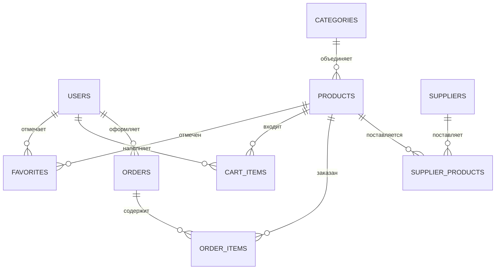

# Схема и словарь данных магазина настольных игр

Исходная структура для PostgreSQL находится в [db/schema.sql](../../db/schema.sql). Идентификаторы основных сущностей создаёт БД. Связи «многие ко многим» вынесены в отдельные таблицы.

Рисунок 1 — Связи таблиц PostgreSQL

| Таблица | Поля и назначение | Целостность |
|---|---|---|
| users | id, email, password_hash, name, phone, avatar_path, role, status, created_at | PK id, уникальность lower(email), допустимые роли и статусы |
| categories | id, name | PK id, обязательный жанр |
| products | id, name, description, price, quantity, image_path, category_id, players_min, players_max, play_time, age | FK категории, цена и остаток от 0, players_min ≥ 1, players_max ≥ players_min, длительность > 0 |
| favorites | user_id, product_id | Составной PK, FK с каскадным удалением отметок |
| cart_items | user_id, product_id, quantity | Составной PK, количество от 0, FK с каскадным удалением |
| orders | id, user_id, status, total, created_at | FK пользователя с запретом удаления при заказах, допустимые статусы, итог от 0 |
| order_items | order_id, product_id, quantity, price | Составной PK, FK заказа каскадный, FK товара с запретом удаления, цена и количество от 0 |
| suppliers | id, name, email, phone, status | PK id, обязательные контактные поля и допустимые статусы |
| supplier_products | supplier_id, product_id | Составной PK, FK с каскадным удалением связей |

Типы идентификаторов и количественных характеристик — `integer`, идентификаторы основных таблиц объявлены `serial`. Цены и итог — `numeric(10,2)`. Имена, строки, статусы и пути — `text`. Время создания — `timestamp` со значением `now()` по умолчанию. Телефон и аватар пользователя, а также изображение товара допускают `NULL`.

В первой нормальной форме каждое поле хранит одно значение. Ассортимент поставщика и состав заказа представлены строками связей. Во второй нормальной форме количество и цена позиции зависят от полной пары «заказ и товар». В третьей нормальной форме данные о категории, контактах поставщика и профиле клиента хранятся в собственных таблицах. Цена в позиции отражает цену продажи в момент добавления позиции. Итог в заказе является сохранённым расчётным значением и изменяется вместе с его составом в одной транзакции.
