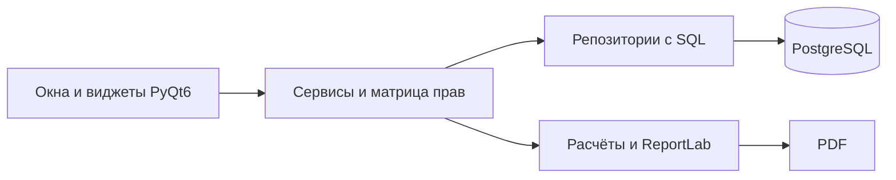
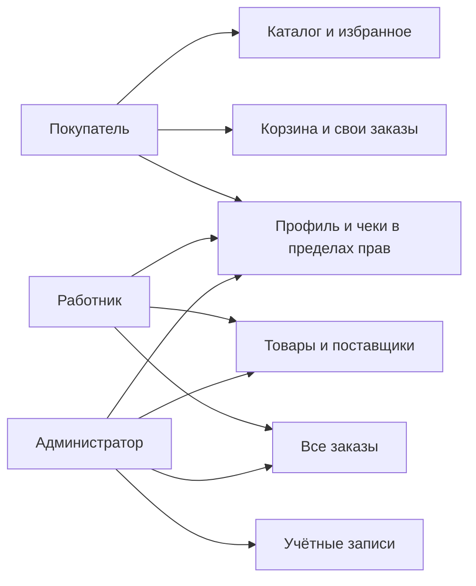
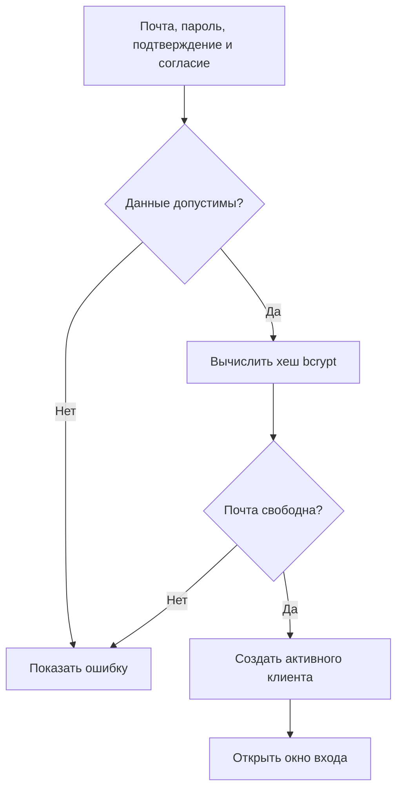
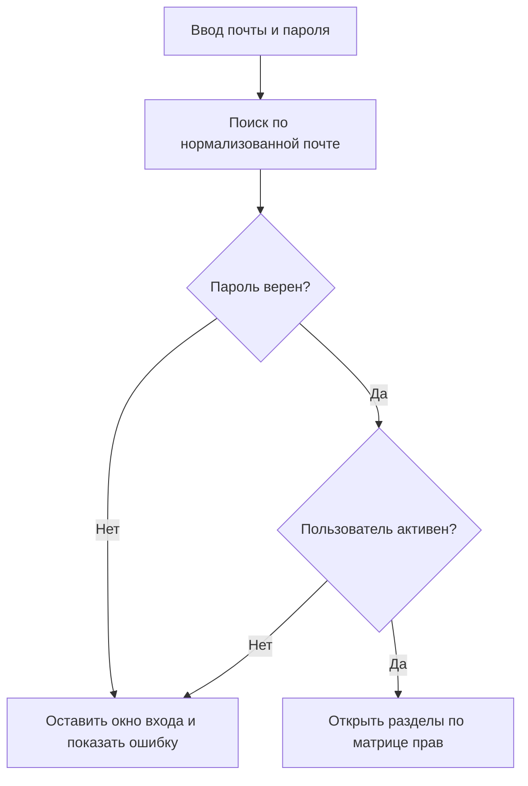
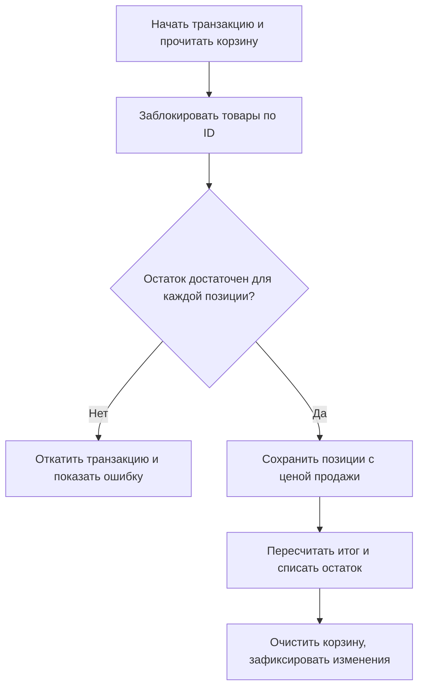
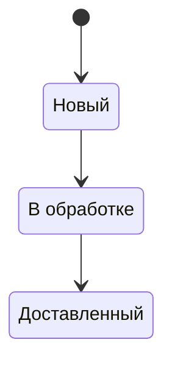
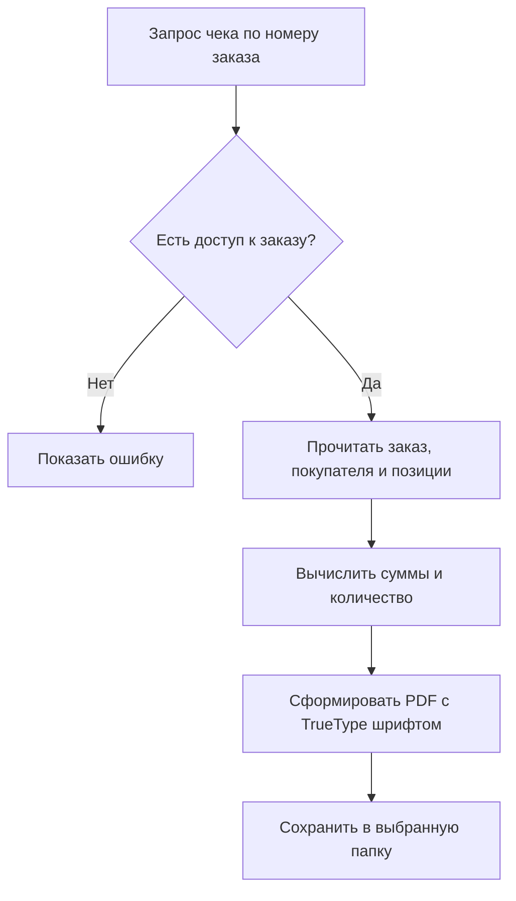

# Диаграммы архитектуры и алгоритмов

Рисунок 1 — Компоненты приложения

Рисунок 2 — Функции по ролям

Рисунок 3 — Регистрация

Рисунок 4 — Вход

Рисунок 5 — Оформление заказа

Рисунок 6 — Переходы заказа

Рисунок 7 — Сохранение чека
